# Audit, Fix, Re-Audit: Bringing Windows 11 from 37.7% to 90.7% DISA STIG Compliance

**Compliance hardening project from my LOG(N) Pacific internship.** I audited a default Windows 11 build against the DISA STIG with Tenable, fixed 136 failed rules with PowerShell (every fix paired with a rollback), re-audited after every change, and documented each rule that could not be fixed in this environment.

`Tenable Vulnerability Management` · `DISA STIG (Windows 11 V2R11)` · `PowerShell` · `Windows Registry` · `auditpol` · `secedit` · `Microsoft Azure`

---

## Key Metrics

| | Before | After |
|---|---|---|
| **STIG compliance (257 rules)** | 37.7% (97 passed) | **90.7%** (233 passed) |
| **Failed rules** | 149 | **13** (−91%) |
| **CAT I failures (most severe)** | 12 | **2** (−83%) |
| **CAT II failures** | 129 | **10** (−92%) |
| **CAT III failures** | 8 | **1** (−88%) |
| **Rules fixed and verified by re-audit** | — | **136** |
| **Regressions (a passing rule that later failed)** | — | **0** across 16 scans |
| **Remaining failures** | — | 13, each documented in [docs/exceptions.md](docs/exceptions.md) |

Baseline audit: November 9, 2026. Final audit (Scan 16): November 14, 2026, 15:20 UTC.

---

## Executive Summary

A **STIG** (Security Technical Implementation Guide) is a configuration standard published by the Defense Information Systems Agency (DISA). The Windows 11 STIG lists every setting a Windows 11 computer must have before it may connect to a Department of Defense network. Each rule has a severity: **CAT I** (most severe), **CAT II**, or **CAT III**.

**Why it matters to an employer:** organizations that work with the U.S. government must meet this standard, and commercial standards such as the CIS Benchmarks are met with the same cycle this project shows: audit, fix, verify, document.

I built a Windows 11 virtual machine in Azure and left it as delivered. Tenable audited it against the STIG: it passed **97 of 257 rules (37.7%)**. A default Windows installation is far from the standard.

Over six days I fixed the failures in small groups. For each group I recorded the setting before the change, applied the fix with a script, saved a rollback script, and ran the audit again to confirm the result. After 16 audits the machine passed **233 of 257 rules (90.7%)**, and no rule that had passed ever failed again.

The last **13 failures** could not be fixed honestly on this machine. Examples: Credential Guard requires a Windows Enterprise license and this image is Windows 11 Pro; DoD certificates belong on DoD networks. I did not fake any of them. Each one is written up with the reason, the evidence, and what the fix would be in production.

## My Role

- **Audited** a default Windows 11 build with an authenticated Tenable compliance scan (DISA Microsoft Windows 11 STIG V2R11)
- **Analyzed** the audit export to group 149 failures by rule family and severity, then planned fixes in batches
- **Remediated** 136 rules with PowerShell, `auditpol` and `secedit`, each change with a recorded before state and a rollback
- **Verified** every batch with a re-audit and a rule-by-rule comparison against the previous scan
- **Investigated** fixes that did not take effect, using the audit's exact check text, boot event logs and Microsoft documentation
- **Documented** 13 exceptions and 11 manual-review items with evidence instead of forcing a pass

---

## 1. Setup

| Item | Value |
|---|---|
| Machine | Azure virtual machine, Windows 11 Pro 25H2, Trusted launch (Secure Boot and virtual TPM) |
| Network | Private IP only, no public IP; reached through Azure Bastion |
| Scanner | Tenable Vulnerability Management, internal scan engine, authenticated with a local administrator account |
| Audit | Advanced Network Scan with the compliance audit "DISA Microsoft Windows 11 STIG V2R11" |
| Baseline | The Windows image as delivered, with no settings weakened on purpose |

Two settings were required by the lab and are part of the baseline: Windows Firewall off (the range requires it for scanning) and `LocalAccountTokenFilterPolicy = 1` (needed so the scanner can log in remotely with a local account). The firewall setting is one of the 13 documented exceptions.

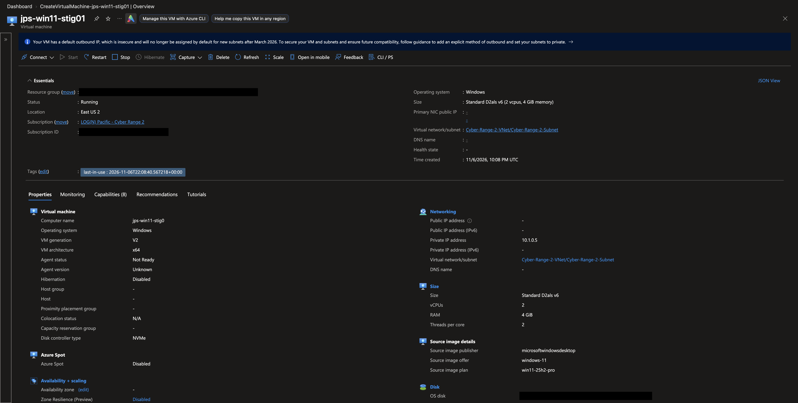

**The first scan returned nothing, and I checked why.** The range provides a ready-made STIG scan template. It logged in successfully and reported vulnerabilities, but **0 audit results**. I confirmed the zero was real by running the same search on a host that did have audit data, then built my own scan from Tenable's Advanced Network Scan template with the STIG audit attached. That scan became the baseline. The empty report is kept in [reports/range-template-scan-no-audits.pdf](reports/range-template-scan-no-audits.pdf).

## 2. Baseline Audit

Tenable checked 257 STIG rules. **149 failed, 11 needed manual review, 97 passed.**

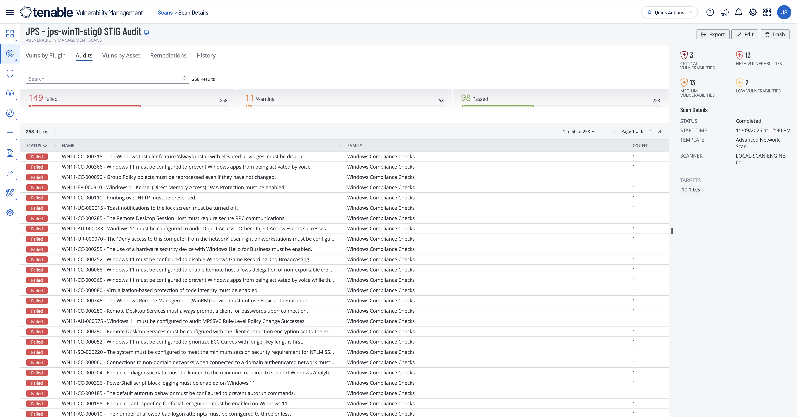

| Severity | Rules | Failed at baseline |
|---|---|---|
| CAT I | 27 | 12 |
| CAT II | 215 | 129 |
| CAT III | 15 | 8 |
| **Total** | **257** | **149** |

**How I count.** Tenable's screen shows 258 results, because one extra row only confirms that the audit file matches the operating system. I excluded it. All percentages in this project are *passed rules divided by 257*. The 11 manual-review items never count as passed, even where my own inspection found them compliant.

## 3. Method

Every change followed the same five steps:

1. **Record the before state** with a read-only command (most values did not exist at all).
2. **Fix** with a script that sets only the values the rule requires.
3. **Save a rollback script** that restores the exact earlier state.
4. **Restart and prove I could still log in** before closing the working session, for any setting that affects logon or boot.
5. **Re-audit** and compare rule by rule with the previous scan: which rules changed, and did anything regress.

Before each re-audit I predicted the result. From Scan 4 onward every prediction matched except one, and that one led to a finding (section 5).

## 4. Remediation, Batch by Batch

| Step | What I changed | Tool | Rules fixed | Scripts |
|---|---|---|---|---|
| 1 | Nine single-rule fixes, including AutoPlay, Windows Installer elevation and WinRM Digest | Registry, `auditpol` | 9 | `WN11-AU-000050`, `WN11-AU-000500`, `WN11-CC-000030`, `-000195`, `-000200`, `-000215`, `-000315`, `-000325`, `-000360` |
| 2 | Audit policy: 29 subcategories plus Security and System log sizes | `auditpol`, registry | 31 | `WN11-AU-batch2.ps1` |
| 3 | Security options: SMB signing, NTLM and LAN Manager levels, anonymous access, UAC | Registry | 16 | `WN11-SO-batch3.ps1` |
| 4 | Password policy, account lockout (3 attempts, 15 minutes) and user rights | `secedit` template | 14 | `WN11-AC-UR-batch4.inf` |
| 5 | DoD logon banner and four more settings | Registry | 5 | `WN11-SO-000075.ps1`, `WN11-batch5.ps1` |
| 6 | FIPS-compliant algorithms | Registry | 1 | `WN11-SO-000230.ps1` |
| 7 | Computer configuration, group 1 | Registry | 10 | `WN11-CC-batch6.ps1` |
| 8 | Computer configuration, group 2 | Registry | 15 | `WN11-CC-batch7.ps1` |
| 9 | Network and credential hardening (IP source routing, WDigest, script block logging) plus the Delivery Optimization fix | Registry | 13 | `WN11-CC-batch8.ps1`, `WN11-CC-000206-config.ps1` |
| 10 | Mixed value types: webcam, SmartScreen, ECC curves, PIN length, PowerShell transcription | Registry | 7 | `WN11-CC-batch9.ps1` |
| 11 | WinRM (no Basic authentication, no unencrypted traffic) and Remote Desktop encryption | Registry | 8 | `WN11-CC-winrm.ps1`, `WN11-CC-rds.ps1` |
| 12 | SMB guest logons, hardened UNC paths, RPC client restriction | Registry | 3 | `WN11-CC-stepc.ps1` |
| 13 | Virtualization-based security and memory integrity | Registry (two locations) | 2 | `WN11-CC-vbs.ps1`, `WN11-CC-vbs-system.ps1` |
| 14 | Kernel DMA protection and Windows Hello hardware requirement | Registry | 2 | `WN11-EP-CC-dma-whfb.ps1` |
| | | **Total** | **136** | |

Every script has a matching `rollback-*.ps1` in [scripts/](scripts/).

Evidence for each step is in [screenshots/](screenshots/). Three examples:

Audit policy before the fix (step 2):

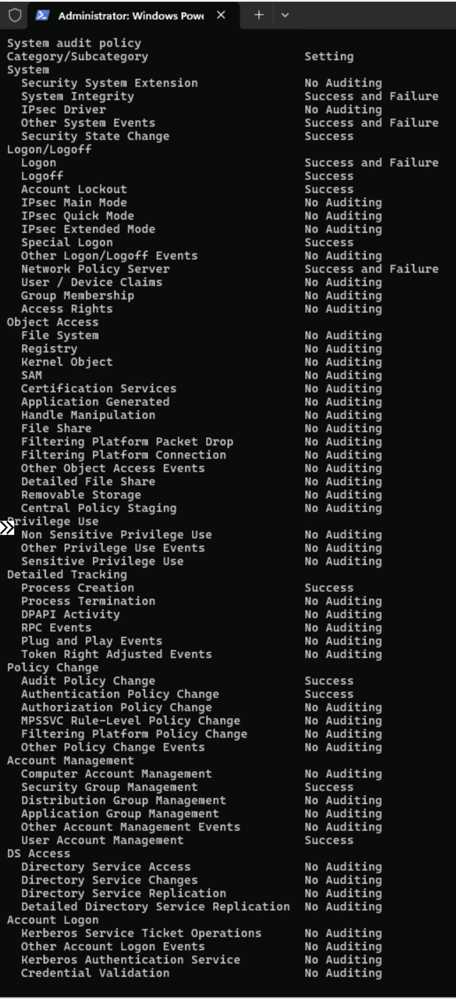

Account and lockout policy after the fix (step 4):

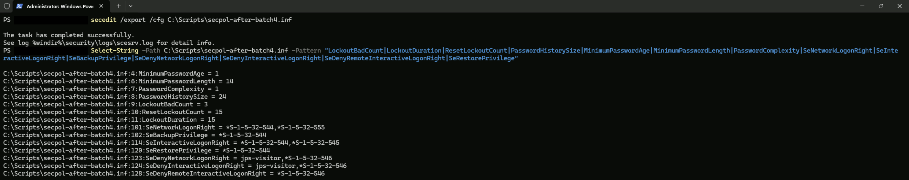

The required legal notice shown at logon (step 5):

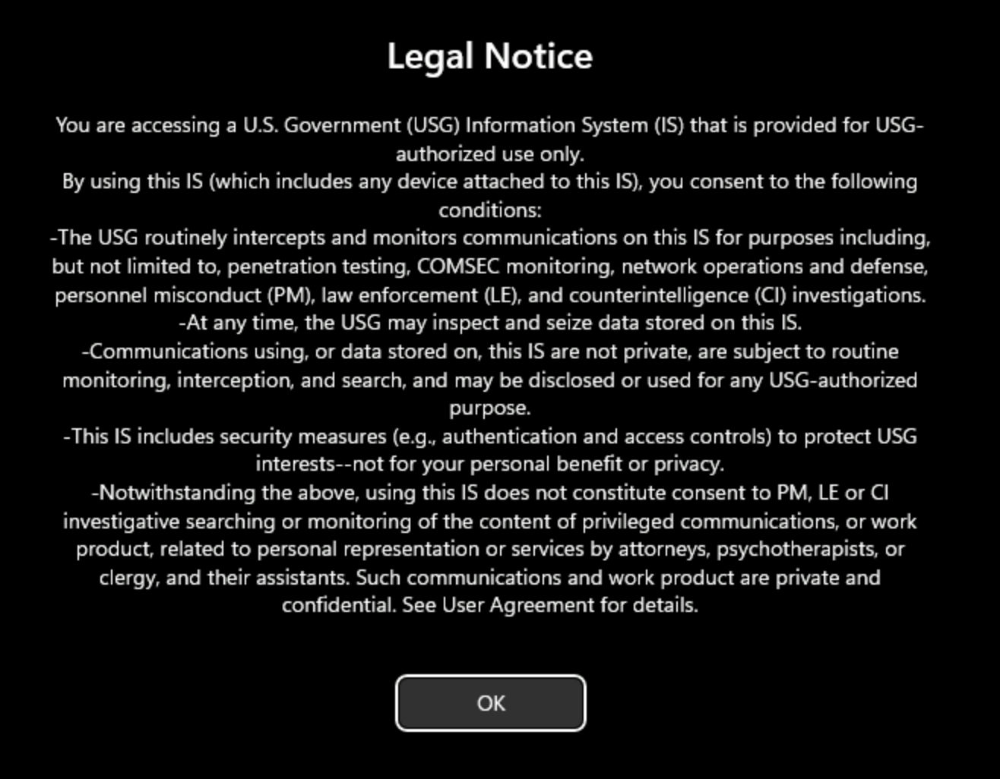

## 5. Three Investigations

### A fix that was correct but still failed (WN11-CC-000206)

I set the Delivery Optimization policy value the rule names. The next audit still failed and reported the value as missing. Read-only checks showed the policy value was present, so I read the audit's exact check. The STIG lists a **second location** for computers that are not managed by a domain, and that is the one Tenable read on this machine. Setting the value there passed the rule on the next scan.

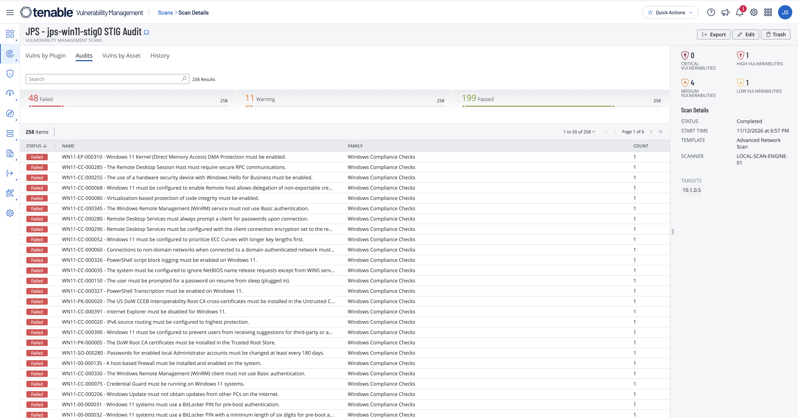

### A security feature that was enabled but not running (WN11-CC-000070, WN11-CC-000080)

Virtualization-based security (VBS) uses the hypervisor to isolate part of Windows memory. I set the three policy values the audit checks and restarted. Windows reported VBS as **enabled but not running**.

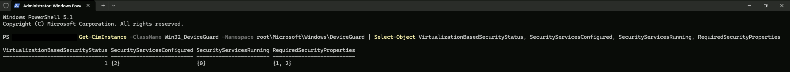

My first explanation, taken from documentation, was that this type of Azure VM blocks the feature. The data disagreed: the processor reported every required virtualization capability. The answer was in the boot log. At every start, including the one after my fix, Windows logged that VBS was disabled with **no policies found**.

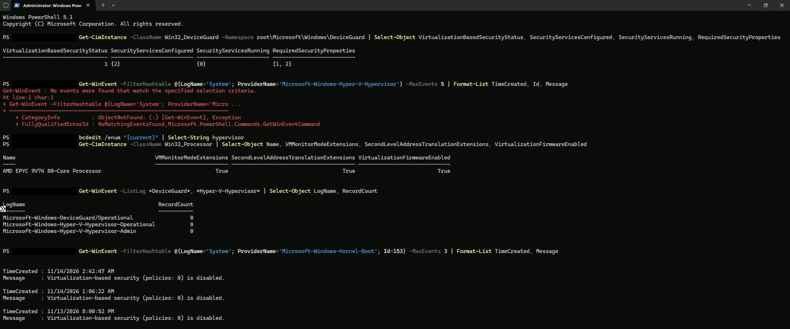

The boot loader starts before most of Windows and reads this configuration from a different part of the registry (the SYSTEM hive) than the policy path the audit checks. Group Policy normally writes both. I had written the registry directly, so only one existed. I added the values Microsoft documents for the registry method, restarted, and VBS and memory integrity were both running.

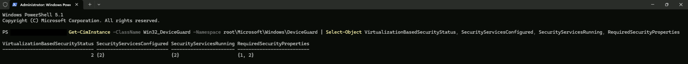

### A rule I tested, proved unfixable here, and rolled back (WN11-CC-000075, CAT I)

Credential Guard isolates stored logon secrets inside VBS. I enabled it in a reversible way to test it. One event log said Credential Guard had started. The interface Tenable reads said it was **not running**. Two sources disagreed, so I checked a third: the operating system edition. The image is **Windows 11 Pro**, and Microsoft licenses Credential Guard only for Windows Enterprise and Education.

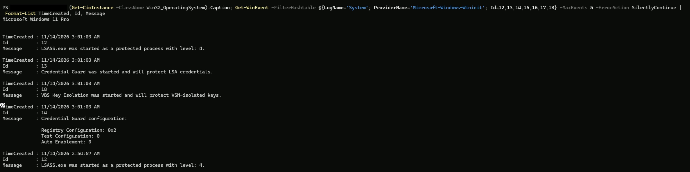

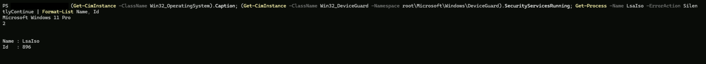

The rule also requires a firmware lock that cannot be undone from Windows. Applying an irreversible setting that would still fail the audit made no sense, so I rolled the test back and documented the exception with its compensating controls.

## 6. Results

| Scan | Date (UTC) | Change before the scan | Failed | Manual review | Passed | Compliance |
|---|---|---|---|---|---|---|
| 1 | Nov 9 | Baseline | 149 | 11 | 97 | 37.7% |
| 2 | Nov 10 | Step 1 | 140 | 11 | 106 | 41.2% |
| 3 | Nov 11 | Step 2 | 109 | 11 | 137 | 53.3% |
| 4 | Nov 11 | Step 3 | 93 | 11 | 153 | 59.5% |
| 5 | Nov 12 | Step 4 | 79 | 11 | 167 | 65.0% |
| 6 | Nov 12 | Step 5 | 74 | 11 | 172 | 66.9% |
| 7 | Nov 12 | Step 6 | 73 | 11 | 173 | 67.3% |
| 8 | Nov 12 | Step 7 | 63 | 11 | 183 | 71.2% |
| 9 | Nov 13 | Step 8 | 48 | 11 | 198 | 77.0% |
| 10 | Nov 13 | Step 9 | 35 | 11 | 211 | 82.1% |
| 11 | Nov 13 | Step 10 | 28 | 11 | 218 | 84.8% |
| 12 | Nov 13 | Step 11 | 20 | 11 | 226 | 87.9% |
| 13 | Nov 14 | Step 12 | 17 | 11 | 229 | 89.1% |
| 14 | Nov 14 | Step 13 | 15 | 11 | 231 | 89.9% |
| 15 | Nov 14 | No changes (verification) | 15 | 11 | 231 | 89.9% |
| 16 | Nov 14 | Step 14 | **13** | 11 | **233** | **90.7%** |

The full final result, one row per rule, is in [results/stig-results-final-scan16.csv](results/stig-results-final-scan16.csv).

**Before (Scan 1) and after (Scan 16):**

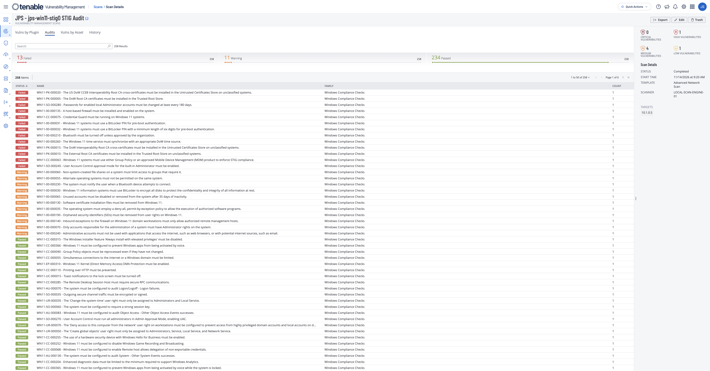

**Vulnerabilities, with honest attribution.** The same scans also report software vulnerabilities. They fell from 3 Critical, 13 High, 13 Medium and 2 Low to 0 Critical, 1 High, 4 Medium and 1 Low. That drop came from **Windows Update installing patches during the project, not from my scripts**. STIG settings and missing patches are separate problems. Reports: [baseline](reports/scan01-baseline-vulns.pdf), [final](reports/scan15-final-vulns.pdf).

## 7. What Is Still Open

**13 rules still fail.** Full detail, evidence and production fixes are in [docs/exceptions.md](docs/exceptions.md).

| Reason | Rules | Count |
|---|---|---|
| Specific to Department of Defense networks (DoD certificates, DoD time source) | WN11-PK-000005, -000010, -000015, -000020, WN11-00-000260 | 5 |
| Needs a domain or device-management service this standalone VM does not have | WN11-CC-000063, WN11-SO-000280, WN11-SO-000245 | 3 |
| Not possible on a cloud virtual machine (pre-boot PIN entry, Bluetooth radio) | WN11-00-000031, WN11-00-000032, WN11-00-000210 | 3 |
| Requires a Windows Enterprise license | WN11-CC-000075 | 1 |
| Conflicts with a lab rule (firewall must be off for scanning) | WN11-00-000135 | 1 |

**11 rules need a human reviewer**, because a scanner cannot decide them. I checked each one by hand: 6 compliant by inspection, 2 not applicable, 2 exceptions, 1 procedural. They are listed in the same document and are **not** counted in the 90.7%.

## What the Evidence Can't Show

- **This is not an accreditation.** A real STIG assessment includes manual checks by an assessor and formal risk acceptance by an authorizing official. This project is the technical part.
- **One machine, one image.** Results apply to a standalone Windows 11 Pro virtual machine. A domain-joined Enterprise workstation would differ: some of my exceptions would become fixable, and other rules would apply.
- **Scripts, not Group Policy.** Production environments enforce STIG settings centrally with Group Policy or a device-management service. Rule WN11-CC-000063 requires exactly that, and it is one of my 13 failures.
- **Passing a rule is not the same as testing its effect.** The audit confirms each setting is present. I tested logon and scanning after risky changes, but I did not test every application against every setting.

## Lessons Learned

- **Read the audit's exact check, not just the rule title.** Two rules I had filed as "impossible here" turned out to be simple values once I read what the scanner really tests.
- **A configured setting is not a running feature.** For anything that starts at boot, check the boot log and the place the boot loader reads.
- **When two sources disagree, find a third.** An event log said "started" while the scanner's source said "not running". The edition and license settled it.
- **Data beats documentation.** My first theory for the VBS failure came from documentation and was wrong. The machine's own logs had the answer.
- **Do not fake compliance.** Writing a registry value to satisfy a check, when the control behind it does not exist, hides a risk instead of removing it.
- **Check the rule ID against the audit.** An older script of mine was named `WN11-CC-000215` but the audit showed it fixes WN11-CC-000190. I kept the file name and corrected the record here.
- **Verify a zero.** The first scan's empty audit result was a tooling problem, not a clean machine.
- **Small batches and a prediction before each scan.** When a result differs from the prediction, the difference is the finding.

## Repository Contents

| Folder | Contents |
|---|---|
| `scripts/` | 26 fix scripts, 20 rollback scripts, 1 `secedit` security template |
| `docs/` | [exceptions.md](docs/exceptions.md): the 13 remaining failures and 11 manual-review items |
| `results/` | Final audit result for all 257 rules (CSV) |
| `screenshots/` | 84 evidence screenshots (redacted), numbered in the order of the work |
| `reports/` | Tenable vulnerability reports (baseline, final) and the empty range-template report |

Cyber-range exercise during my Cybersecurity Analyst internship at LOG(N) Pacific. Lab virtual machine in a shared training environment; not a production or Department of Defense system. Screenshots redacted.
